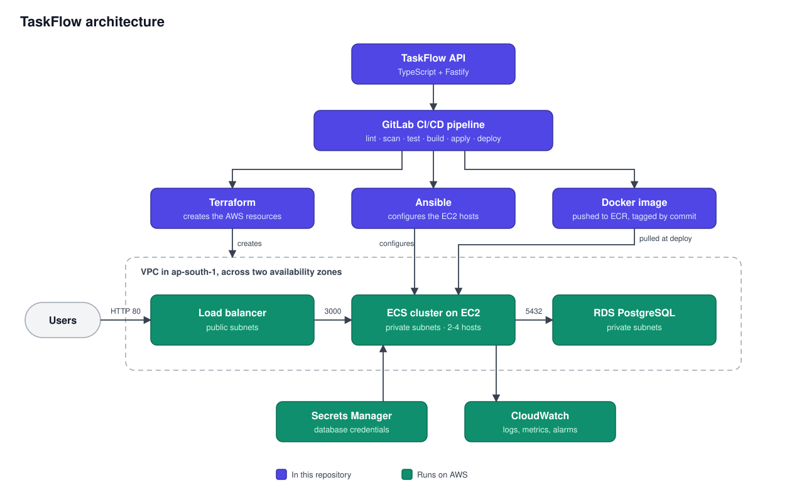

# Architecture

The purple boxes are what this repository defines; the green ones run on AWS. Only the load
balancer is reachable from the internet. The ECS hosts and the database sit in private subnets,
across two Availability Zones in `ap-south-1`.

## How a request flows

1. A user sends HTTP to the load balancer's public DNS name on port 80. The load balancer's
   security group is the only rule in the stack open to the internet.
2. The load balancer forwards it to a healthy API task on port 3000. Each task has its own network
   interface (`awsvpc`), and its security group accepts traffic only from the load balancer.
3. The API validates the request and queries PostgreSQL over TLS on port 5432, as the restricted
   `taskflow_app` role. The database's security group accepts only the tasks' security group.
4. The response returns along the same path. It carries an `x-request-id` header, which also
   appears in that task's log line in CloudWatch.

## Around the request path

- **Secrets Manager** holds the database credentials. The ECS agent reads them when a task starts
  and passes them in as environment variables, so they are never in the image or the task
  definition.
- **CloudWatch** receives the tasks' logs and the ECS and load balancer metrics.
- **The hosts** accept no inbound connections. Operators and Ansible reach them through Systems
  Manager Session Manager, and their outbound HTTPS (image pulls, secrets, logs) leaves through a
  NAT gateway in a public subnet.

The design decisions are recorded in the ADRs: [EC2 hosting](adr/0001-ecs-hosting-model.md),
[runtime and database access](adr/0002-api-runtime-and-database-access.md),
[container base image](adr/0003-container-base-image.md) and
[Terraform state](adr/0004-terraform-state-backend.md).
